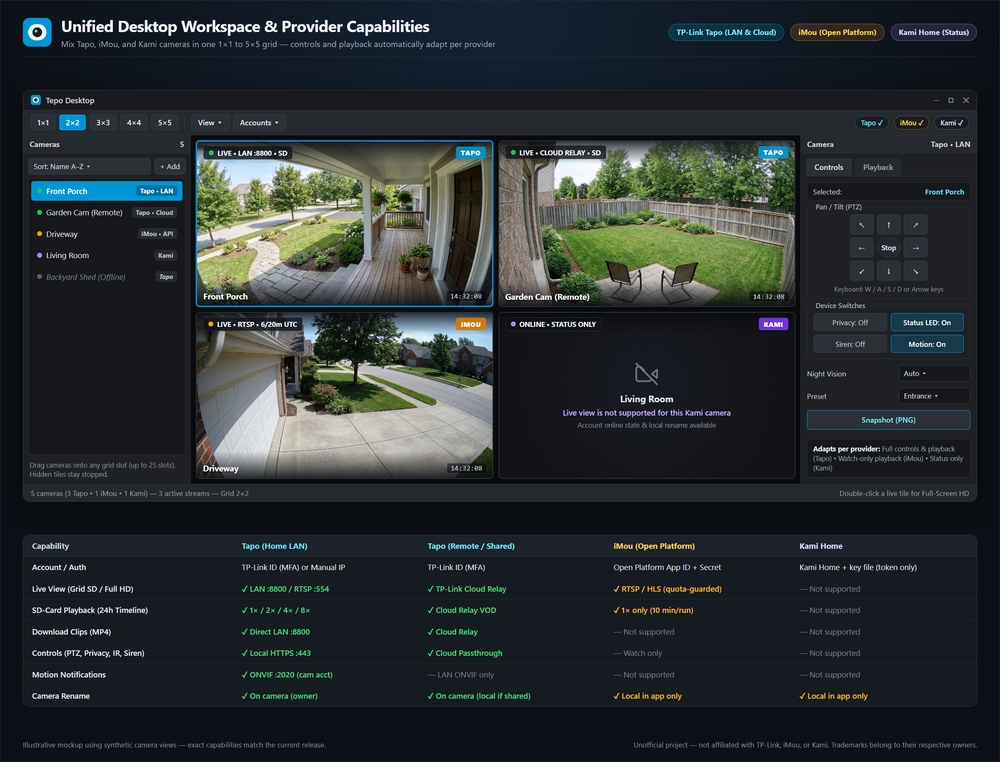
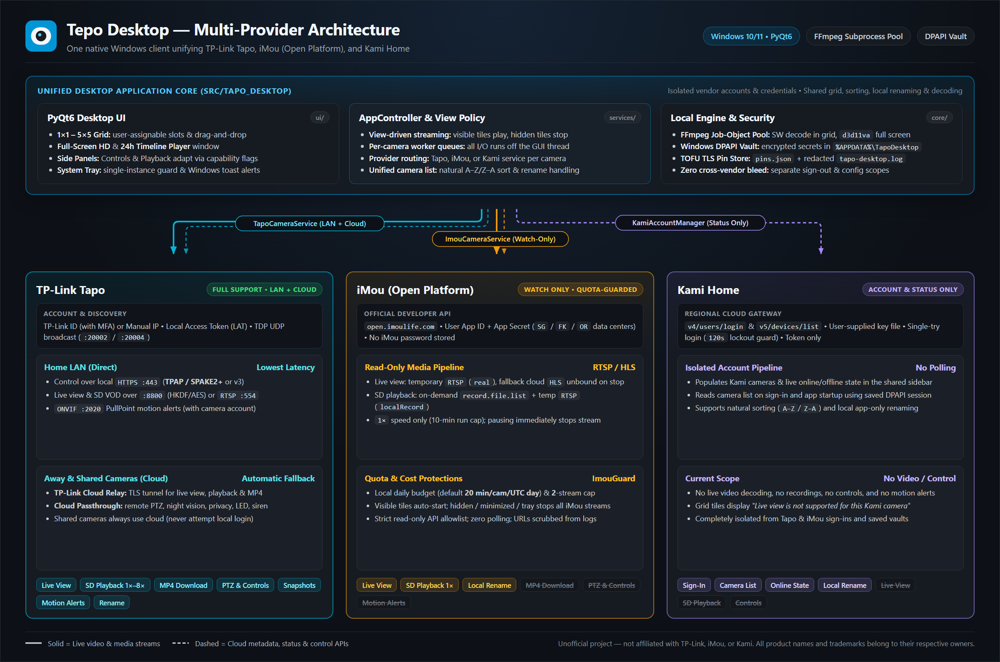

# Tepo Desktop for Windows

Unofficial native Windows desktop client for **TP-Link Tapo**, **iMou (Open Platform)**, and **Kami Home** cameras. Not affiliated with TP-Link, iMou, or Kami; all product names and trademarks belong to their respective owners.

Sign in with your accounts in one app to monitor cameras in a unified `1x1` to `5x5` grid, full-screen HD view, and 24-hour recordings player. Step-by-step setup guides are published on the [Tepo Desktop website](https://drak905.github.io/Tepo-Camera-Desktop/).

## Multi-Provider Overview (Tapo, iMou, Kami)



| Provider | What works | Setup & details |
|---|---|---|
| **TP-Link Tapo** (LAN & Cloud) | Full support: live view (at home and away/shared), PTZ & device controls, 24h SD playback (`1x`–`8x`), MP4 downloads, snapshots, motion alerts, rename | [Tapo sign-in guide](https://drak905.github.io/Tepo-Camera-Desktop/tapo.html) |
| **iMou** (Open Platform) | Watch only: live view (`RTSP` / `HLS`) and `1x` memory-card playback with local daily minute budget & concurrent stream cap; local rename only | [iMou sign-in guide](https://drak905.github.io/Tepo-Camera-Desktop/imou.html) &bull; [docs/IMOU.md](docs/IMOU.md) |
| **Kami Home** | Account sign-in, camera list, online/offline state, sorting, and local rename only (live view, playback, and controls are not supported) | [Kami sign-in guide](https://drak905.github.io/Tepo-Camera-Desktop/kami.html) |

### How it works under the hood



Each provider runs through an isolated account and service pipeline behind one shared PyQt6 UI, view-driven stream policy, FFmpeg decoding pool, and Windows DPAPI credential vault:

- **TP-Link Tapo (`TapoCameraService`):** Auto-discovers LAN cameras via TDP (`20002`/`20004`), controls them over local `HTTPS :443` (`TPAP / SPAKE2+` or Secure v3, using Local Access Tokens when required), and streams live view and SD playback over `:8800` (`HKDF`/`AES`) or `RTSP :554` plus `ONVIF :2020` motion events. Away and shared cameras route automatically over the **TP-Link Cloud Relay** (TLS tunnel for live view, SD playback, and MP4 downloads) and **Cloud Passthrough** (`services-sync` for remote controls).
- **iMou Open Platform (`ImouCameraService`):** Connects to `open.imoulife.com` (`sg`, `fk`, or `or`) using your own free developer **App ID** and **App Secret** without storing your iMou password. Live view requests a temporary `RTSP` URL (falling back to cloud `HLS`, unbound on stop), and playback queries `record.file.list` on demand for temporary `1x` `RTSP` playback (10-minute run cap; pause stops the stream). `ImouGuard` enforces a local daily minute budget (default `20 min/cam/UTC day`), concurrent stream cap (default `2`), auto-stop when minimized/hidden to tray, and a strict read-only API allowlist.
- **Kami Home (`KamiAccountManager`):** Authenticates against Kami's regional cloud gateway (`v4/users/login`, `v5/devices/list`) using a user-supplied key file, single-attempt login (120s lockout guard), and DPAPI-stored session token. Populates cameras and online state in the shared list and grid slots with local app-only renaming.

## Features (Tapo full support)

| Feature | Camera interface |
|---|---|
| Live view in a `1x1` to `5x5` grid (25 assignable slots, drag & drop), double-click for full-screen HD | LAN `:8800` / `RTSP :554` (`/stream2` SD in grid, `/stream1` HD full screen; `/stream6`/`/stream7` dual-lens) or TP-Link Cloud Relay |
| Pan/tilt pad, `W`/`A`/`S`/`D` or arrow keys, saved presets | Local `HTTPS :443` (`motorMove`, `singalMove`, presets) or Cloud Passthrough |
| Privacy mode, night vision (auto / IR on / IR off), status LED, siren, motion detection, PNG snapshots | Local `HTTPS :443` or Cloud Passthrough |
| SD-card recordings: 24-hour timeline player (`1x`/`2x`/`4x`/`8x`), clip list, MP4 download | `HTTPS :443` + media port `:8800`, or Cloud Relay VOD |
| Motion notifications (Windows toast via the tray icon) | `ONVIF :2020` PullPoint events (LAN with camera account) |
| A–Z / Z–A / account sorting, camera renaming, system tray, single-instance guard, auto-reconnect | On-camera rename for owned Tapo cams; local rename for shared/IP/iMou/Kami |

## Install
Run the setup file `TepoDesktop-<version>-setup.exe` (per-user install, no admin rights), or unzip
`TepoDesktop-<version>-win64.zip` and run `TepoDesktop\TepoDesktop.exe`. FFmpeg is bundled.
The app was called "Tapo Desktop" before. The setup upgrades an old install and keeps your saved sign-ins and
settings (they stay in `%APPDATA%\TapoDesktop`). Pictures are now saved in `Pictures\Tepo Desktop`; old pictures stay
where they are. Web filter or firewall exceptions for `TapoDesktop.exe` must be made again for `TepoDesktop.exe`.

## Getting started
1. Start Tepo Desktop and **sign in with your TP-Link ID** (the email and password you use in the Tapo app), or choose
   **Use without account** if you only use manual IP cameras, iMou, or Kami. If your TP-Link ID has 2-step verification,
   enter the code the dialog asks for.
2. Tapo cameras appear with their cloud names; cameras on your home network are found automatically and stream over LAN,
   while away and shared Tapo cameras stream through the TP-Link cloud relay.
3. Open the **account button** in the top bar to connect **iMou (Open Platform)** or **Kami Home** alongside Tapo.
4. Select any camera to use the **Controls** and **Playback** panels, drag cameras into grid slots (`1x1`–`5x5`),
   or double-click a live tile for full-screen HD. See [Using the app](https://drak905.github.io/Tepo-Camera-Desktop/usage.html).

## Notes
- Cameras on newer Tapo firmware (`encrypt_type` 4, such as the C200 on 1.5.x) use TP-Link's newer login
  (`SPAKE2+` / `TPAP`), and cameras in Local Access Token (`LAT`) mode retrieve tokens automatically from your account.
  A wrong password is never retried automatically (120s cooldown) so cameras do not lock you out.
- Passwords, session tokens, and API secrets are encrypted with Windows DPAPI (`%APPDATA%\TapoDesktop\vault.json`),
  readable only by your Windows user. **Add** (by IP) is available for Tapo cameras not linked to an account.
- If local Tapo live view or SD downloads fail, check that no local web filter (for example AdGuard) intercepts
  traffic from `TepoDesktop.exe` or `ffmpeg.exe`. Tapo media port `8800` uses plain HTTP.

## Development
Agents and new contributors: start with [AGENTS.md](AGENTS.md) (handover: state, rules, protocol facts, open items).

```powershell
python -m venv .venv; .venv\Scripts\pip install -e .[dev]
.venv\Scripts\python -m tapo_desktop            # run from source
powershell -File tools/run.ps1 verify-specs     # Gate 1: protocol spec evidence check
powershell -File tools/run.ps1 test-tdd         # Gate 2: unit + mock-camera + chaos + UI tests
powershell -File tools/run.ps1 test-soak        # Gate 3: 30-min 4-camera soak (TAPO_SOAK_SECONDS)
powershell -File tools/run.ps1 test-hardware -Ip 192.168.x.y   # Gate 3: live camera (see tests/hardware)
powershell -File tools/run.ps1 smoke            # real app stack vs 2 mock cameras + screenshot
powershell -File tools/run.ps1 build-windows    # Gate 4: PyInstaller + Inno Setup + audit + selftest
```
The npm aliases in `package.json` (`npm run test:tdd-all`, and so on) call the same tasks.

Layout: `src/tapo_desktop/core` (auth, control_client, cloud, discovery, imou, kami, media_engine, vod, onvif_service),
`services` (controller, account managers, camera services, stream policy, view layout), `ui` (PyQt6).
`tests/fixtures/mock_tapo_server` is a stateful mock camera (HTTPS, RTSP, ONVIF, :8800) with a chaos TCP proxy.
The interface contracts are in `docs/`.
The Tapo protocol spec is in `specs/tapo_protocol_spec.json`; it was extracted from the Tapo Android app
3.22.806 with JADX/REA. Every item cites its evidence. The release build contains no APK material
(`tools/audit_release.py`).
