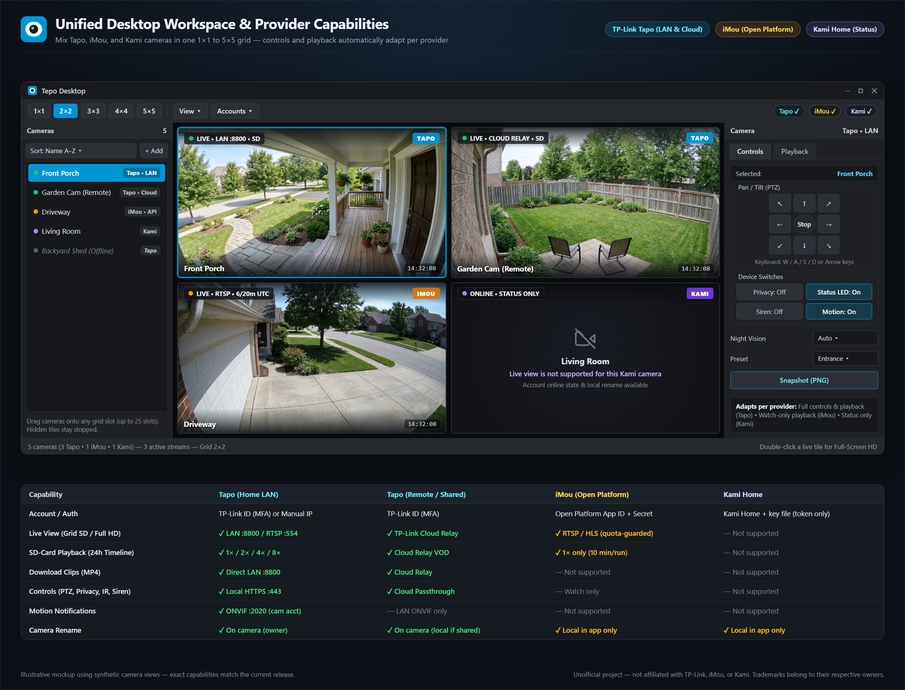
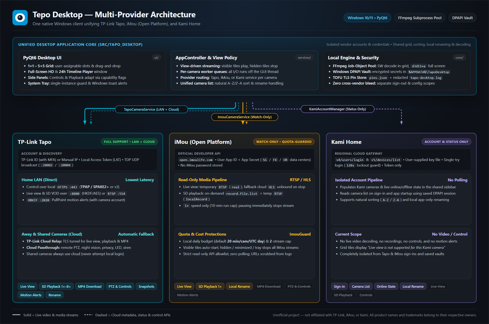

# Tepo Desktop cho Windows

[English](README.md) | **Tiếng Việt**

Ứng dụng desktop Windows không chính thức dành cho camera **TP-Link Tapo**, **iMou (Open Platform)** và **Kami Home**. Dự án độc lập, không liên kết hay được ủy quyền bởi TP-Link, iMou hoặc Kami; mọi tên sản phẩm và nhãn hiệu thuộc về chủ sở hữu tương ứng.

Đăng nhập các tài khoản camera trong cùng một ứng dụng để theo dõi trên lưới hợp nhất từ `1x1` đến `5x5`, xem toàn màn hình HD và phát lại bản ghi 24 giờ trên thẻ nhớ. Xem hướng dẫn cài đặt và sử dụng chi tiết trên [trang hướng dẫn Tepo Desktop (Tiếng Việt)](https://drak905.github.io/Tepo-Camera-Desktop/vi/).

## Tổng quan đa hãng camera (Tapo, iMou, Kami)



| Hãng camera | Khả năng hỗ trợ | Hướng dẫn & chi tiết |
|---|---|---|
| **TP-Link Tapo** (LAN & Cloud) | Hỗ trợ đầy đủ: xem trực tiếp (tại nhà qua LAN và từ xa / camera được chia sẻ qua cloud), điều khiển PTZ & cài đặt thiết bị, xem lại thẻ nhớ 24h (`1x`–`8x`), tải clip MP4, chụp ảnh nhanh, thông báo chuyển động, đổi tên | [Hướng dẫn đăng nhập Tapo](https://drak905.github.io/Tepo-Camera-Desktop/vi/tapo.html) |
| **iMou** (Open Platform) | Chỉ xem: xem trực tiếp (`RTSP` / `HLS`) và xem lại thẻ nhớ tốc độ `1x`, có giới hạn phút mỗi ngày & giới hạn luồng chạy đồng thời; chỉ đổi tên cục bộ trong ứng dụng | [Hướng dẫn kết nối iMou](https://drak905.github.io/Tepo-Camera-Desktop/vi/imou.html) &bull; [docs/IMOU.md](docs/IMOU.md) |
| **Kami Home** | Chỉ đăng nhập tài khoản, hiển thị danh sách camera, trạng thái online/offline, sắp xếp và đổi tên cục bộ (không hỗ trợ xem trực tiếp, phát lại hay điều khiển) | [Hướng dẫn đăng nhập Kami](https://drak905.github.io/Tepo-Camera-Desktop/vi/kami.html) |

### Cách hoạt động bên trong



Mỗi hãng camera chạy qua một nhánh tài khoản và dịch vụ tách biệt, cùng dùng chung giao diện PyQt6, cơ chế phát theo khung hình hiển thị, nhóm tiến trình giải mã FFmpeg và kho lưu trữ bảo mật Windows DPAPI:

- **TP-Link Tapo (`TapoCameraService`):** Tự động tìm camera trong mạng LAN qua TDP (`20002`/`20004`), điều khiển qua `HTTPS :443` nội bộ (`TPAP / SPAKE2+` hoặc Secure v3, tự lấy Local Access Token khi cần), phát trực tiếp và phát lại thẻ nhớ qua `:8800` (`HKDF`/`AES`) hoặc `RTSP :554`, nhận cảnh báo chuyển động qua `ONVIF :2020`. Camera ở xa hoặc camera được người khác chia sẻ tự động đi qua **TP-Link Cloud Relay** (xem trực tiếp, phát lại và tải MP4) và **Cloud Passthrough** (`services-sync` cho điều khiển từ xa).
- **iMou Open Platform (`ImouCameraService`):** Kết nối tới `open.imoulife.com` (`sg`, `fk` hoặc `or`) bằng **App ID** và **App Secret** từ tài khoản nhà phát triển miễn phí của chính bạn (không lưu mật khẩu iMou). Xem trực tiếp lấy địa chỉ `RTSP` tạm thời (dự phòng cloud `HLS`, tự hủy khi dừng); xem lại gọi `record.file.list` theo nhu cầu và phát `RTSP` tốc độ `1x` (giới hạn 10 phút mỗi lượt, tạm dừng sẽ ngắt luồng). `ImouGuard` áp dụng định mức phút/ngày (mặc định `20 phút/camera/ngày UTC`), giới hạn số luồng đồng thời (mặc định `2`), tự dừng khi thu nhỏ / ẩn xuống khay hệ thống và chỉ cho phép các lệnh API chỉ-đọc.
- **Kami Home (`KamiAccountManager`):** Xác thực qua cổng cloud khu vực của Kami (`v4/users/login`, `v5/devices/list`) bằng tệp khóa do người dùng tự cung cấp, gửi duy nhất 1 lần mỗi lượt bấm (khóa 120 giây nếu sai) và chỉ lưu session token trong DPAPI. Hiển thị danh sách camera và trạng thái online/offline trong danh sách chung với tính năng đổi tên cục bộ.

## Tính năng (hỗ trợ đầy đủ với Tapo)

| Tính năng | Giao thức / cơ chế |
|---|---|
| Xem trực tiếp trên lưới `1x1` đến `5x5` (25 vị trí tùy chọn, kéo & thả), nhấp đúp để xem toàn màn hình HD | LAN `:8800` / `RTSP :554` (`/stream2` SD trên lưới, `/stream1` HD toàn màn hình; `/stream6`/`/stream7` cho camera 2 ống kính) hoặc TP-Link Cloud Relay |
| Bàn điều khiển xoay/nghiêng PTZ, phím `W`/`A`/`S`/`D` hoặc phím mũi tên, vị trí lưu sẵn (presets) | `HTTPS :443` nội bộ (`motorMove`, `singalMove`, presets) hoặc Cloud Passthrough |
| Chế độ riêng tư, đèn hồng ngoại ban đêm (tự động / bật / tắt IR), đèn LED trạng thái, còi hú, phát hiện chuyển động, chụp ảnh PNG | `HTTPS :443` nội bộ hoặc Cloud Passthrough |
| Bản ghi thẻ nhớ SD: trình phát dòng thời gian 24 giờ (`1x`/`2x`/`4x`/`8x`), danh sách clip, tải về MP4 | `HTTPS :443` + cổng media `:8800`, hoặc Cloud Relay VOD |
| Thông báo chuyển động (thông báo nổi Windows qua biểu tượng khay hệ thống) | Sự kiện `ONVIF :2020` PullPoint (trên mạng LAN với Camera account) |
| Sắp xếp A–Z / Z–A / theo tài khoản, đổi tên camera, thu gọn xuống khay hệ thống, chống mở trùng cửa sổ, tự kết nối lại | Ghi tên lên camera với Tapo chính chủ; lưu cục bộ trong app với camera chia sẻ/IP/iMou/Kami |

## Cài đặt
Chạy tệp cài đặt `TepoDesktop-<version>-setup.exe` (cài theo người dùng Windows hiện tại, không cần quyền quản trị viên), hoặc giải nén `TepoDesktop-<version>-win64.zip` và chạy `TepoDesktop\TepoDesktop.exe`. Bộ giải mã FFmpeg đã được đóng gói sẵn.
Trước đây ứng dụng có tên là "Tapo Desktop". Trình cài đặt sẽ nâng cấp trực tiếp từ bản cũ và giữ nguyên tài khoản đã đăng nhập cùng cấu hình (lưu tại `%APPDATA%\TapoDesktop`). Ảnh chụp nhanh hiện lưu tại `Pictures\Tepo Desktop` (ảnh cũ vẫn giữ nguyên ở thư mục cũ). Nếu bạn từng thêm ngoại lệ tường lửa hoặc bộ lọc web cho `TapoDesktop.exe`, hãy thêm lại cho `TepoDesktop.exe`.

## Bắt đầu nhanh
1. Mở Tepo Desktop và **đăng nhập bằng TP-Link ID** (email và mật khẩu dùng trong ứng dụng Tapo), hoặc chọn
   **Use without account** (Dùng không cần tài khoản) nếu bạn chỉ dùng camera thêm theo IP, iMou hoặc Kami. Nếu tài khoản bật xác minh 2 bước, nhập mã xác nhận khi hộp thoại yêu cầu.
2. Camera Tapo sẽ tự hiện lên với tên đã đặt trong ứng dụng Tapo; các camera cùng mạng LAN tự động tìm thấy và phát trực tiếp nội bộ, còn camera ở xa hoặc được chia sẻ phát qua TP-Link cloud relay.
3. Mở nút tài khoản (**account button**) trên thanh công cụ phía trên để kết nối thêm **iMou (Open Platform)** hoặc **Kami Home** song song với Tapo.
4. Chọn một camera bất kỳ để dùng bảng **Controls** (Điều khiển) và **Playback** (Phát lại), kéo camera vào ô lưới (`1x1`–`5x5`), hoặc nhấp đúp vào ô đang phát để mở toàn màn hình HD. Xem thêm tại [Hướng dẫn sử dụng](https://drak905.github.io/Tepo-Camera-Desktop/vi/usage.html).

## Lưu ý
- Camera Tapo chạy firmware mới (`encrypt_type` 4, ví dụ C200 trên 1.5.x) sử dụng cơ chế đăng nhập mới của TP-Link (`SPAKE2+` / `TPAP`), và các camera bật Local Access Token (`LAT`) sẽ tự động lấy token từ tài khoản của bạn.
  Khi nhập sai mật khẩu, ứng dụng không tự thử lại (chờ 120 giây) để tránh khóa camera.
- Mật khẩu, session token và khóa API được mã hóa bằng Windows DPAPI (`%APPDATA%\TapoDesktop\vault.json`), chỉ tài khoản Windows của bạn mới giải mã được. Nút **Add** (theo địa chỉ IP) luôn sẵn sàng cho camera Tapo không gắn với tài khoản cloud.
- Nếu xem trực tiếp nội bộ hoặc tải bản ghi từ thẻ nhớ bị lỗi, hãy kiểm tra xem có trình lọc web nào (ví dụ AdGuard) chặn lưu lượng của `TepoDesktop.exe` hoặc `ffmpeg.exe` hay không. Cổng media `8800` của camera Tapo dùng HTTP thuần.

## Phát triển (Development)
Dành cho cộng tác viên và coding agent: hãy đọc [AGENTS.md](AGENTS.md) trước (bàn giao trạng thái, quy tắc an toàn, chi tiết giao thức và các hạng mục mở).

```powershell
python -m venv .venv; .venv\Scripts\pip install -e .[dev]
.venv\Scripts\python -m tapo_desktop            # chạy từ mã nguồn
powershell -File tools/run.ps1 verify-specs     # Gate 1: kiểm tra bằng chứng đặc tả giao thức
powershell -File tools/run.ps1 test-tdd         # Gate 2: unit + mock-camera + chaos + UI tests
powershell -File tools/run.ps1 test-soak        # Gate 3: soak test 30 phút 4 camera (TAPO_SOAK_SECONDS)
powershell -File tools/run.ps1 test-hardware -Ip 192.168.x.y   # Gate 3: test phần cứng thật (xem tests/hardware)
powershell -File tools/run.ps1 smoke            # chạy thử toàn app với 2 mock camera + chụp màn hình
powershell -File tools/run.ps1 build-windows    # Gate 4: đóng gói PyInstaller + Inno Setup + audit + selftest
```
Các lệnh npm trong `package.json` (`npm run test:tdd-all`, v.v.) gọi cùng các tác vụ tương ứng.

Cấu trúc mã nguồn: `src/tapo_desktop/core` (`auth`, `control_client`, `cloud`, `discovery`, `imou`, `kami`, `media_engine`, `vod`, `onvif_service`), `services` (`controller`, trình quản lý tài khoản, dịch vụ camera, `stream_policy`, `view_layout`), `ui` (PyQt6). `tests/fixtures/mock_tapo_server` là máy chủ giả lập camera đầy đủ trạng thái (HTTPS, RTSP, ONVIF, :8800) kèm chaos TCP proxy. Tài liệu giao diện nằm trong `docs/`. Đặc tả giao thức Tapo nằm trong `specs/tapo_protocol_spec.json` (trích xuất clean-room từ ứng dụng Android Tapo 3.22.806 bằng JADX/REA, có dẫn chứng cụ thể cho từng mục). Bản phát hành không chứa bất kỳ tài nguyên APK nào (`tools/audit_release.py`).
